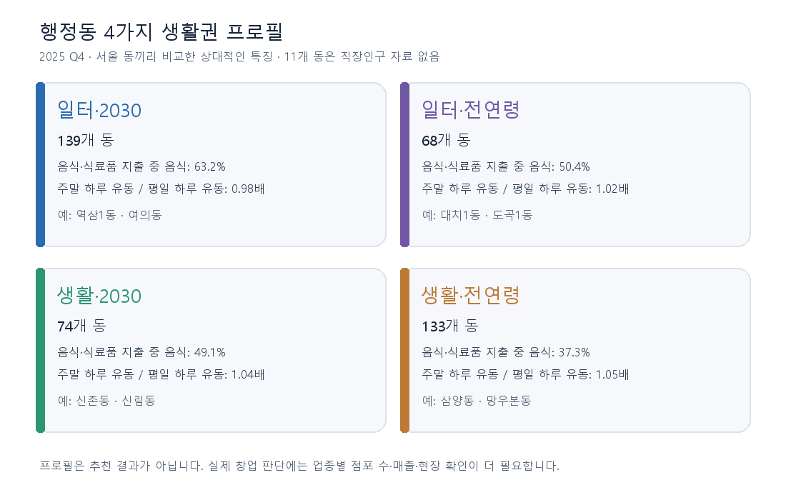
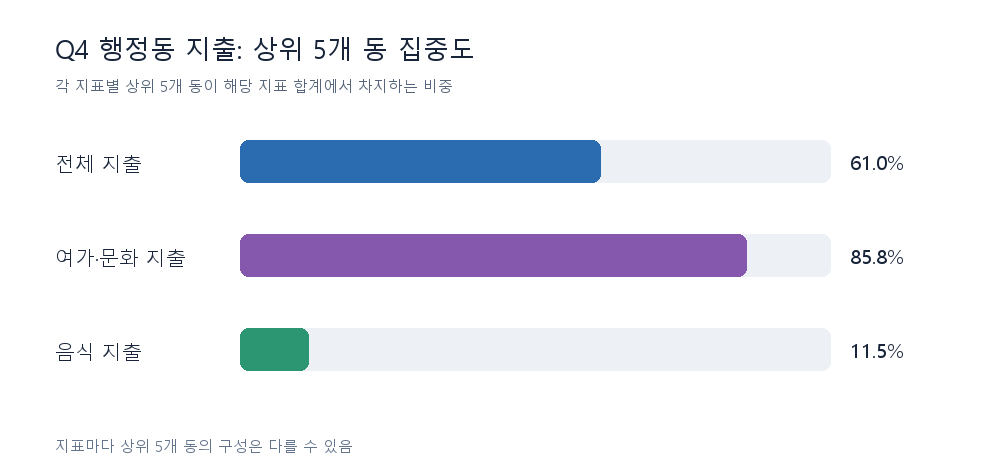
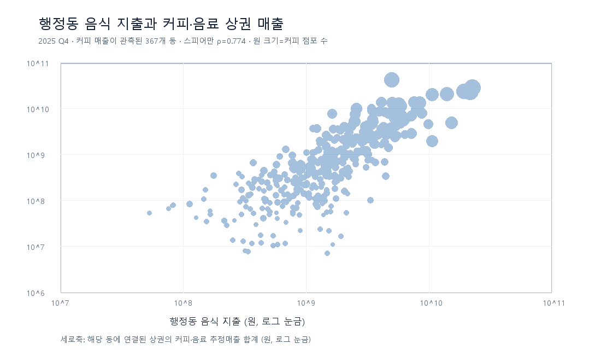

# 박성은 EDA: 서울 동네의 특징과 창업 상권 살펴보기

> **분석 자료:** 저장소 `data/raw/`의 2025년 자료. 동네 특징은 2025년 4분기(Q4)를 기준으로 만들었다. 원천 CSV는 바꾸지 않았다.

## 먼저 읽는 결론

- 서울의 **행정동 425개**를 살펴보니, 414개 동은 ‘일하는 사람이 상대적으로 많은가’와 ‘오가는 사람 중 20·30대가 상대적으로 많은가’라는 두 질문으로 **4가지 생활권 프로필**을 만들 수 있었다. 직장인구 자료가 없는 **11개 동은 분류하지 않았다**.
- 상권의 **매출 총액만으로 창업 장소를 고르면 위험**하다. 2025 Q4 매출이 관측된 상권 1,565개 중 상위 16개가 전체 관측 매출의 **26.9%**를 차지했다. 가게가 많은 곳은 매출 총액도 커지기 쉽다.
- 음식점·카페를 살펴볼 때 행정동의 **전체 지출액만 보면 다른 업종의 큰 거래에 끌릴 수 있다.** Q4 전체 지출의 상위 5개 동 비중은 **61.0%**지만, 음식 지출의 상위 5개 동 비중은 **11.5%**다. 음식 지출이 높은 동은 커피 점포도 많은 경향이 있어 경쟁을 같이 봐야 한다.

**이 문서의 4가지 생활권 프로필은 팀의 금융 MBTI(L/V·E/P·S/G)와 별개**다. 동네의 관측된 특징을 쉽게 설명하려는 첫 분류이며, 창업 성공 여부나 추천 결과를 뜻하지 않는다. 다른 팀원 보고서는 구성 방식을 참고했지만, 아래 계산은 `박성은` 폴더의 스크립트로 원천 CSV에서 다시 했다.

## 이 문서에서 쓰는 말

| 말 | 쉽게 말하면 |
|---|---|
| EDA | 데이터가 어떻게 생겼는지 먼저 살펴보고, 다음에 확인할 질문을 찾는 작업 |
| 행정동 | 소공동·역삼1동처럼 행정 업무를 위해 나눈 ‘동’. 이번 자료에는 425개가 있다. |
| 상권 | 서울시가 가게들이 모인 곳을 구역으로 묶은 것. 한 동에 여러 상권이 있을 수 있다. |
| 유동인구 | 그곳을 오가는 사람의 **추정 규모**. 실제 서로 다른 방문객 수와 같다고 보지 않는다. |
| 추정매출 | 원천 자료가 추정한 매출. 가게의 확정 장부 매출이나 순이익이 아니다. |
| 중앙값 | 수치를 작은 순서로 놓았을 때 한가운데 값. 몇몇 아주 큰 동의 영향을 덜 받는다. |
| 점포당 매출 | 상권·업종 매출 합계를 점포 수 합계로 나눈 **비교용 숫자**. 개별 가게의 예상 매출이 아니다. |

자료를 연결하는 순서는 **행정동(425개) → 그 동에 배정된 상권(1,650개) → 상권 안의 업종별 매출·점포 수**다. 399개 동에는 상권이 하나 이상 배정되어 있다. Q4에 매출 행이 있는 상권은 1,565개이고, 이들은 397개 동에 배정된다. 나머지 동·상권은 **매출이 0원이라고 확인된 것이 아니라 이 파일에 매출 행이 없는 것**이다.

## 1. 행정동을 4가지 생활권 프로필로 보면

### 두 질문으로 나누었다

1. **일터 쪽인가, 생활 쪽인가?** 동의 `직장인구 ÷ 상주인구`를 계산했다. 서울에서 값이 있는 414개 동의 중앙값은 **0.111**이다. 이보다 높으면 ‘일터’, 낮으면 ‘생활’이라고 **상대적으로** 표시했다. ‘일터’라고 해서 그 동의 직장인이 주민보다 반드시 많다는 뜻은 아니다.
2. **오가는 사람 중 20·30대가 많은 편인가?** `(20대 유동인구 + 30대 유동인구) ÷ 전체 유동인구`를 계산했다. 425개 동의 중앙값은 **29.1%**다. 이보다 높으면 ‘2030’, 낮으면 ‘전연령’으로 표시했다. ‘전연령’은 모든 연령이 고르게 섞였다는 뜻이 아니라 **2030 비중이 서울 동의 중앙값보다 낮다**는 뜻이다.

각 값이 기준값과 정확히 같으면 높은 쪽에 넣었다. 직장인구 자료가 없는 11개 동은 ‘자료 없음’으로 남겼다. 실제 고객이 주민인지 방문객인지, 소비자가 20·30대인지 직접 측정한 유형은 아니다.



| 생활권 프로필 | 동 수 | 직장인구/상주인구 중앙값 | 2030 유동 비중 중앙값 | 음식·식료품 지출 중 음식 비중 중앙값 |
|---|---:|---:|---:|---:|
| 일터·2030 | **139** | 0.35 | 35.9% | 63.2% |
| 일터·전연령 | **68** | 0.23 | 25.6% | 50.4% |
| 생활·2030 | **74** | 0.06 | 34.1% | 49.1% |
| 생활·전연령 | **133** | 0.05 | 25.4% | 37.3% |
| 직장인구 자료 없음 | **11** | 계산 불가 | 계산 가능 | 계산 가능 |

마지막 열은 유형을 만드는 데 **사용하지 않은 값**이다. 음식 지출과 식료품 지출을 합친 금액 중 음식 지출이 차지하는 비율을 따로 살펴본 것이다. 일터·2030형에서 63.2%, 생활·전연령형에서 37.3%로 차이가 있었다. 이것만으로 동네 사람의 외식 선호나 카페의 수익성을 판단할 수는 없다.

### 실제 동을 읽는 예시

| 동 | 유형 | 직장인구/상주인구 | 2030 유동 비중 | 주말 하루 유동/평일 하루 유동 | 자료에서 읽히는 특징 |
|---|---|---:|---:|---:|---|
| 역삼1동 | 일터·2030 | 5.93 | 50.2% | 0.71배 | 직장인구 비율이 높고, 주말 유동은 평일보다 적다. |
| 대치1동 | 일터·전연령 | 0.77 | 13.3% | 1.02배 | 직장인구 비율은 서울 동의 중간보다 높지만, 2030 유동 비중은 낮다. |
| 신림동 | 생활·2030 | 0.058 | 60.3% | 1.11배 | 젊은 유동 비중은 높지만, 직장인구/상주인구는 낮다. |
| 삼양동 | 생활·전연령 | 0.005 | 24.4% | 1.09배 | 두 기준 모두 서울 동의 중간보다 낮다. |

주말/평일 비율은 각각 **하루 평균 유동인구**를 비교한 값이다. 1보다 작으면 주말 하루 평균이 평일 하루 평균보다 적다는 뜻이다. 두 값이 비슷해도 시간대나 방문 목적은 다를 수 있다. 이 표는 창업 적합도를 매긴 순위가 아니다.

**[425개 행정동별 결과표](eda_tables/Q4_행정동_생활권_프로필.csv)**에서 자기 동의 유형, 두 기준의 실제 수치, 주말 유동, 음식·식료품 지출을 확인할 수 있다. 원천에 `?`로 나온 일부 동 이름은 이 결과표에서 화면 표시용 `·`로 바꿨다. 동을 연결할 때는 이름이 아닌 코드를 썼다.

### 유형을 얼마나 조심해서 읽어야 하나

- 두 기준 가운데 하나라도 중앙값에 가까운 동은 **76개**다(기준값 앞뒤 순위 5%p). 결과표에 `중앙값 근처`라고 표시했다. 이 동들의 유형은 기준을 조금 바꾸면 달라질 수 있다.
- 2030 유동 비중을 2025 Q1로 바꿔 같은 Q4 기준에 대입하면, 직장인구 자료가 있는 414개 동 중 **12개 동의 2030/전연령 표시가 달라진다**. 시기에 따라 달라질 수 있는 스냅샷이다.
- ‘일터·2030’과 ‘생활·전연령’이 어떤 창업 아이템에 유리하다는 **검증 결과는 아직 없다**. 유형은 추천 모델의 정답이 아니라 동네를 읽는 출발점이다.

## 2. 동네에서 실제로 무엇이 많이 쓰였나



| 2025 Q4 행정동 지출 | 425개 동 합계 | 한 동의 중앙값 | 각 항목의 상위 5개 동 비중 |
|---|---:|---:|---:|
| 전체 지출 | 13.798조 원 | 48.18억 원 | **61.0%** |
| 여가·문화 지출 | 8.837조 원 | — | **85.8%** |
| 음식 지출 | 0.809조 원 | 11.92억 원 | **11.5%** |

전체 지출의 64.0%는 여가·문화 항목이다. 예를 들어 전체 지출 상위 동인 **소공동·구로3동·문래동**에서는 여가·문화가 각 동 전체 지출의 **97.9%·99.3%·99.3%**다. 반면 음식 지출 상위 동은 **종로1·2·3·4가동·서교동·역삼1동**이다. 그러므로 음식점·카페 수요를 보면서 ‘전체 지출이 가장 큰 동’을 곧바로 고르면 엉뚱한 항목의 큰 거래에 끌릴 수 있다.

행정동 **음식 지출**과 상권 **업종별 추정매출**은 조사 대상과 집계 방식이 다른 숫자다. 두 금액을 빼서 ‘아직 쓰지 않은 돈’이나 ‘소비 갭’을 만들지 않았다.

## 3. 사람이 많으면 가게 매출도 높을까

행정동의 특징은 동네 전체의 **배경**이고, 창업 후보를 볼 때는 **어느 상권의 어느 업종인지**까지 내려가야 한다. Q4 업종별 매출 21,333행을 점포 자료와 연결하면, 매출이 관측된 상권 1,565개를 행정동별·업종별로 다시 묶을 수 있다. 그 결과 관측된 `행정동 × 업종` 조합은 **11,594개**다. 동네 유동인구는 업종 행마다 여러 번 더하지 않고 동별로 한 번만 붙였다.

| Q4 업종 | 매출이 관측된 상권 | 관측 상권의 점포 수 합계 | 관측 상권의 추정매출 합계 |
|---|---:|---:|---:|
| 한식음식점 | 1,406 | 50,152개 | 3.986조 원 |
| 커피·음료 | 1,069 | 20,997개 | 0.686조 원 |
| 호프·간이주점 | 882 | 13,511개 | 0.728조 원 |

**커피·음료**를 예로 보면, 음식 지출이 높은 동에 커피 매출이 관측되는 경향이 있다. 하지만 **커피 점포 수도 함께 많다.** 음식 지출 상위 25%의 동 107개 중 105개에서 커피 매출이 관측됐고, 그 105개 동에 배정된 상권의 커피 점포 수 중앙값은 **104개**다. 음식 지출 하위 25%에서는 107개 동 중 68개에서 커피 매출이 관측됐고, 이 68개의 점포 수 중앙값은 **10.5개**다. 매출 행이 없는 곳의 점포를 0개라고 간주한 비교가 아니다.



동네 단위에서 음식 지출과 커피 매출은 **함께 커지는 경향**이 있다. 그러나 같은 업종을 상권끼리 비교하면, 커피 매출은 상권 유동인구보다 **커피 점포 수**와 더 강하게 함께 커진다(순위 상관계수 각각 **0.246**, **0.738**). ‘순위 상관계수’는 두 숫자의 큰 순서가 얼마나 비슷한지를 보는 값으로, 1에 가까울수록 순서가 비슷하다. 가게가 여럿이면 **총매출**도 커질 수 있으므로, 이 결과가 점포 하나의 수익이 높다는 뜻은 아니다.

### 상권 매출의 크기와 분기 변화


Q4 매출이 관측된 상권 1,565개의 **상권별 매출 중앙값은 34.3억 원**이고, 상위 10%가 시작되는 값은 **349.1억 원**이다. 상위 16개 상권의 매출이 전체 관측 매출의 **26.9%**를 차지한다. 큰 상권의 총매출만 보고 작은 골목 상권보다 창업에 낫다고 말할 수 없는 이유다.

2025년 네 분기 모두 매출이 있는 상권 1,560개를 같은 상권끼리 비교하면, Q1 대비 Q4 매출 변화율의 중앙값은 **+7.3%**, 매출이 늘어난 상권은 **1,124개**다. 이는 **2025년 안의 분기 비교**다. 2024년 같은 분기와 비교한 성장률은 이 저장소의 2025년 원천 자료만으로 계산할 수 없다.

상권의 ‘일터 성격’을 매출만으로 단정하기도 어렵다. **직장인구 밀도**(상권 면적 1ha당 직장인구)와 **평일 매출 비중**의 순위 상관계수는 **0.212**로 약했다. 평일 매출이 높아도 직장인구가 적은 상권, 그 반대인 상권이 함께 있다.


## 4. SpotFit에서는 어떻게 쓸까

1. **먼저 동네의 배경을 보여 준다.** ‘일터·2030’처럼 행정동 프로필을 표시하되, 두 기준의 실제 숫자와 `중앙값 근처` 표시를 함께 보여 준다. 예를 들어 역삼1동과 신림동은 모두 2030 유동이 많은 편이지만 일터 비중은 다르다.
2. **그다음 같은 업종끼리 상권을 비교한다.** 커피 창업을 가정했다면 커피 매출·점포 수·폐업점포 수를 상권별로 놓고, 유동인구의 요일·시간대도 확인한다. ‘동네 음식 지출이 크다’는 이유 하나로 후보를 추천하지 않는다.
3. **창업자 금융 MBTI는 따로 연결한다.** 팀의 L/V·E/P·S/G는 창업자와 상권에 대한 별도 설계다. 이 문서의 생활권 프로필은 그 옆에 붙는 **지역 설명**이다. 실제 임대료, 창업 비용, 손익, 현장 상황은 이 데이터에 없으므로 ‘수익이 보장되는 곳’으로 표현하지 않는다.

## 5. 숫자를 읽을 때의 제한

- **자료 시점:** 이 저장소의 원천은 2025년 Q1~Q4다. 2026년 현재의 점포 현황이나 2024년 대비 성장률을 말하지 않는다.
- **인구 변화:** 직장인구와 상주인구 원천은 각 상권의 2025년 네 분기 값이 동일하다. 이 값으로 분기별 인구 증가를 설명하지 않는다.
- **빠진 자료:** Q4 행정동 직장인구는 11개 동에서 없고, 상권 유동인구는 매출이 있는 상권 중 2개에서 없다. 빠진 값을 0으로 채우지 않았다.
- **연령의 의미:** 프로필의 2030은 **유동인구의 연령 비중**이다. 매출 파일의 연령별 금액은 Q4 업종 행 21,333개 중 12,637개에서 전체 매출과 합이 맞지 않아 고객의 완전한 연령 분포로 쓰지 않았다.
- **지도 단위:** 상권 파일에 적힌 행정동 코드로 상권을 동에 배정했다. 상권이 동 경계를 가로지르더라도 매출을 경계에 따라 나눈 값은 아니다. 상권이 없는 26개 동, Q4 상권 매출 행이 없는 28개 동은 ‘시장 없음’으로 해석하지 않는다.
- **상관과 분류:** 같이 커진다는 관계는 원인·결과나 창업 성공을 증명하지 않는다. 행정동 소비와 상권 매출도 서로 다른 원천 지표여서 차감하지 않았다. 프로필 경계에 가까운 76개 동은 특히 조심해서 읽는다.

## 자료와 재현 방법

| 살펴본 내용 | 주로 사용한 원천 CSV (`data/raw/` 아래) |
|---|---|
| 행정동 프로필 | `OA-22178_길단위인구_행정동.csv`, `OA-22184_직장인구_행정동.csv`, `OA-22183_상주인구_행정동.csv`, `OA-22166_소비_행정동.csv` |
| 상권·업종 매출과 점포 | `상권/OA-15572_추정매출_상권.csv`, `상권/OA-15577_점포_상권.csv` |
| 상권을 동에 연결 | `상권/OA-15560_영역_상권.csv`, `OA-22160_영역_행정동.csv` |
| 유동인구와 자치구 이름 | `상권/OA-15568_길단위인구_상권.csv`, `OA-22167_소비_자치구.csv` |

저장소 루트에서 아래 두 명령을 실행하면 `pandas`와 `Pillow`로 분석 숫자를 다시 출력하고 이 문서의 그림 5개와 **[425개 동 결과표](eda_tables/Q4_행정동_생활권_프로필.csv)**를 다시 만든다. 원천 파일은 읽기만 한다.

```bash
python 박성은/eda_raw_상권_2025.py
python 박성은/eda_raw_행정동_2025.py
```
