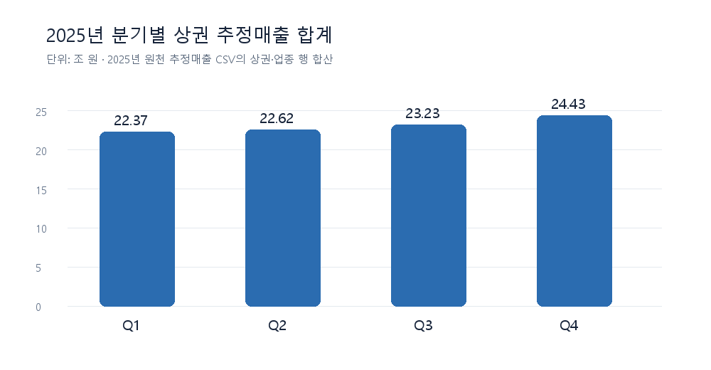
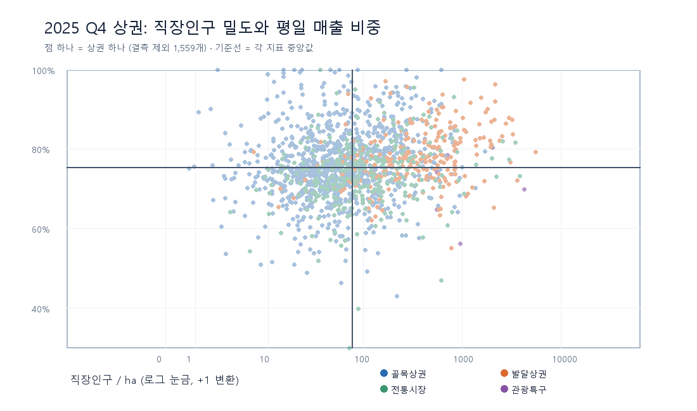

# 2025년 서울 상권 원천 데이터 EDA

> 박성은 개인 분석 · `data/raw/상권/`의 CSV를 직접 집계 · 분석 기준: 저장소에 있는 2025년 1~4분기 자료

## 핵심 발견

1. **2025 Q4 추정매출이 있는 상권은 1,565개**다. 영역 파일의 1,650개 중 85개는 Q4 매출 행이 없다. 매출 행이 없다는 이유만으로 매출이 0원이라고 처리하면 안 된다.
2. Q4 상권별 매출 합계의 중앙값은 **34.3억 원**, 상위 10% 경계는 **349.1억 원**이다. 상위 16개 상권이 관측된 상권 매출 합계의 **26.9%**를 차지한다. 규모가 다른 상권의 매출액만 비교해 창업 후보를 순위화하면 극단값의 영향을 크게 받는다.
3. 동일한 1,560개 상권을 비교하면 Q4 매출은 Q1보다 **중앙값 기준 7.3% 높고**, 1,124개(72.1%)에서 증가했다. 이것은 **2025년 안의 분기 비교**이며 전년 대비 성장률이나 다음 분기 예측 성능을 뜻하지 않는다.
4. 직장인구 밀도와 평일 매출 비중의 상권별 스피어만 상관계수는 **0.212**다. 출근형 상권을 두 지표만으로 명확히 나누기 어렵다. 유동인구의 요일 분포와 상주인구를 함께 봐야 한다.
5. 직장인구·상주인구 파일은 각 상권의 **2025 Q1~Q4 값이 모두 동일**하다. 이 파일들로 2025년 분기별 인구 증가나 감소를 설명할 수 없다.

## 1. 분석 범위와 단위

| 원천 파일 (`data/raw/상권/`) | 원본 행 수 | 단위 | 이번 EDA에서 쓴 값 |
|---|---:|---|---|
| `OA-15560_영역_상권.csv` | 1,650 | 상권 | 상권유형, 면적 |
| `OA-15572_추정매출_상권.csv` | 85,732 | 분기 × 상권 × 서비스업종 | 추정매출액, 매출건수, 평일·연령별 매출 |
| `OA-15577_점포_상권.csv` | 304,775 | 분기 × 상권 × 서비스업종 | 점포 수, 폐업점포 수 |
| `OA-15568_길단위인구_상권.csv` | 6,595 | 분기 × 상권 | 유동인구, 요일별 유동인구 |
| `OA-15569_직장인구_상권.csv` | 6,564 | 분기 × 상권 | 직장인구 |
| `OA-15584_상주인구_상권.csv` | 6,532 | 분기 × 상권 | 상주인구 |

매출의 `당월_매출_금액`은 원천 열 이름 그대로 사용했다. 이 파일의 행은 `기준_년분기_코드`로 구분되므로, **같은 분기 안에서 업종별 행을 합산**했다. 아래의 `상권 매출`은 해당 상권의 여러 서비스업종 매출 합계다. 전체 상권 합계는 이 자료의 관측 범위에 대한 합계이며 서울시 전체 소비액이나 점포의 확정 회계 매출로 해석하지 않는다.

결합 키는 상권 단위 파일에 `기준_년분기_코드 + 상권_코드`, 업종 단위 파일에 `기준_년분기_코드 + 상권_코드 + 서비스_업종_코드`를 썼다. 영역 파일만 `상권_코드`로 결합했다. 업종별 매출 85,732행은 같은 키의 점포 행 85,732개와 모두 연결된다. 다만 점포 파일은 매출 파일보다 업종 범위가 넓다(각각 100개, 62개 업종).

## 2. 2025년 분기 흐름

| 분기 | 매출 행 수 | 매출이 있는 상권 수 | 관측 상권의 추정매출 합계 |
|---|---:|---:|---:|
| 2025 Q1 | 21,427 | 1,572 | 22.374조 원 |
| 2025 Q2 | 21,452 | 1,570 | 22.621조 원 |
| 2025 Q3 | 21,520 | 1,569 | 23.233조 원 |
| 2025 Q4 | 21,333 | 1,565 | 24.430조 원 |

단순 합계는 Q1 대비 Q4가 9.2% 높다. 비교 대상 상권 수가 분기마다 달라서, **4개 분기에 모두 매출이 있는 1,560개 상권**도 따로 확인했다. 그 상권들의 개별 `(Q4 매출 / Q1 매출) - 1`의 중앙값은 **+7.3%**이고 1,124개가 증가했다. 계절성·물가·업종 구성 변화를 분리하지 않았으므로 이를 구조적 성장이나 창업 성공 신호로 쓰지 않는다. 저장소에는 2024년 상권 매출이 없어 전년 동기 비교도 할 수 없다.

## 3. Q4 상권별 매출은 얼마나 다른가

Q4 매출 업종 행 21,333개를 상권별로 합치면 1,565개다. 매출 합계는 **24.430조 원**, 상권별 중앙값 **34.3억 원**, 90백분위 **349.1억 원**, 99백분위 **1,590.1억 원**이다. 상위 16개 상권(약 1%)의 합계 비중은 **26.9%**다.

| 상권유형 | Q4 매출 상권 수 | 상권별 매출 중앙값 | 객단가 중앙값 | 평일 매출 비중 중앙값 | 직장인구/ha 중앙값 |
|---|---:|---:|---:|---:|---:|
| 골목상권 | 1,030 | 19.8억 원 | 25,725원 | 75.2% | 56.6명 |
| 전통시장 | 280 | 46.9억 원 | 26,375원 | 73.6% | 85.5명 |
| 발달상권 | 249 | 348.4억 원 | 28,536원 | 77.5% | 379.4명 |
| 관광특구 | 6 | 2,077.5억 원 | 33,436원 | 72.0% | 836.9명 |

객단가는 **상권의 업종별 매출액 합계 ÷ 매출건수 합계**다. 직장인구/ha는 **직장인구 ÷ (상권 면적㎡ / 10,000)**으로 계산했다. 관광특구는 6개뿐이므로 다른 유형과 단순 평균·순위로 비교하기 어렵다. 유형별 면적과 업종 구성이 달라 매출 총액 차이가 수요 우위나 이익률을 바로 뜻하지 않는다. 특히 직장인구 밀도가 가장 높은 관광특구의 평일 매출 비중 중앙값은 네 유형 중 가장 낮다. 한 지표만으로 ‘오피스형’을 단정하기 어려운 사례다.

### 업종을 고정하면 보이는 경쟁 규모

| Q4 서비스업종 | 매출 행이 있는 상권 수 | 추정매출 합계 | 같은 행의 점포 수 합계 | 매출/점포 수 |
|---|---:|---:|---:|---:|
| 한식음식점 | 1,406 | 3.986조 원 | 50,152 | 약 7,948만 원 |
| 호프-간이주점 | 882 | 0.728조 원 | 13,511 | 약 5,386만 원 |
| 커피-음료 | 1,069 | 0.686조 원 | 20,997 | 약 3,269만 원 |

마지막 열은 **해당 업종·상권 행의 추정매출 합계 ÷ 그 행들의 점포 수 합계**다. 개별 점포 매출이나 이익이 아니다. 예를 들어 커피-음료는 매출이 관측된 상권이 1,069개이고 점포 수 합계가 20,997개라 경쟁 밀도를 함께 봐야 한다. 추천 후보를 만들 때는 `상권 × 업종`을 기준 단위로 두고, 같은 업종 안에서 수요와 점포 수를 비교하는 편이 적절하다.

## 4. ‘상권 DNA’ 가설을 원천 지표로 확인

이전 예비분류 엑셀 대신 **원천 CSV에서 직접** Q4의 `평일 매출 비중 = 주중_매출_금액 합계 / 매출액 합계`와 `직장인구/ha`를 계산했다. 직장인구가 있는 1,559개 상권에서 두 지표의 중앙값은 각각 **75.42%**, **76.28명/ha**다.

| 탐색용 구분 | 상권 수 | 요일별 유동인구 중 평일 비중 중앙값 | 상주인구 중앙값 |
|---|---:|---:|---:|
| 두 지표 모두 중앙값 이상 | 461 | 72.6% | 1,332명 |
| 두 지표 모두 중앙값 미만 | 460 | 70.3% | 2,227명 |
| 한 지표만 중앙값 이상 | 638 | 70.8% | 1,760명 |
| 직장인구 결측 | 6 | 73.6% | 95명 |

두 지표의 스피어만 상관계수는 **0.212**로 약한 양의 관계다. 두 지표가 모두 높은 군은 모두 낮은 군보다 유동인구의 평일 비중이 **2.3%p 높고**, 상주인구 중앙값은 낮다. 방향성은 출근 중심 가설과 맞지만, 겹치는 점이 많고 유형별 분포도 달라 **실제 방문자·거주자의 구성이나 상권 유형을 검증한 것은 아니다**. 산점도의 가로축은 직장인구 밀도에 1을 더한 뒤 로그 눈금으로 표시했다. 두 지표가 엇갈리는 638개는 억지로 양쪽 중 하나로 분류하지 않는다.

## 5. 품질 점검과 해석 제한

| 점검 | 결과 | EDA에서의 처리 |
|---|---|---|
| Q4 매출 상권 → 영역 파일 | 1,565 / 1,565 연결 | 영역·유형 정보 결합 가능 |
| 전체 매출 행 → 같은 분기·상권·업종의 점포 행 | 85,732 / 85,732 연결 | 업종별 매출과 점포 수 함께 탐색 가능 |
| Q4 매출 상권 → Q4 유동인구 | 2개 결측 | 0으로 대체하지 않음 |
| Q4 매출 상권 → Q4 직장인구 | 6개 결측 | 밀도·산점도 계산에서 제외 |
| Q4 매출 상권 → Q4 상주인구 | 15개 결측 | 0으로 대체하지 않음 |
| 직장인구와 상주인구의 2025년 분기 변화 | 1,641개 직장인구 상권, 1,633개 상주인구 상권에서 4개 분기 값 동일 | 시계열 변화 지표로 사용하지 않음 |
| Q4 업종 행의 연령별 매출 합계 vs 전체 매출 | 21,333행 중 12,637행 불일치. 합계 차액은 전체 매출의 12.0% | `2030 매출 비중`을 소비자 연령의 완전한 분포로 해석하지 않음 |

연령별 금액의 합이 전체보다 큰 행도 16개 있다. 연령 미분류 거래 및 집계 방식의 영향을 확인해야 하므로, 연령별 비중으로 추천 대상을 단정하지 않는다. 주중+주말 매출은 Q4 모든 업종 행에서 전체 매출과 일치했다. `data/raw`의 다른 단위인 행정동 소비액은 이 상권 매출과 1:1로 합치거나 차감하지 않았다.

## 6. SpotFit 다음 분석 제안

1. **추천 단위 확정:** 먼저 `2025년 분기 × 상권코드 × 서비스업종코드` 패널을 만들고, 같은 업종 안에서 매출·점포 수·폐업점포 수를 비교한다. 전체 업종 합계만으로 후보를 뽑지 않는다.
2. **수요와 경쟁 분리:** 매출액·매출건수·유동인구는 수요 신호로, 같은 업종 점포 수와 폐업점포 수는 경쟁·위험 신호로 따로 보여준다. `매출/점포 수`는 총량 지표이며 점포별 수익 예측값이 아니다.
3. **예측 검증:** 2025 Q1~Q3 특성으로 Q4를 예측하는 시간 순서 검증을 먼저 시도한다. 네 분기뿐이라 일반화 성능을 주장하기 어렵고, 전년 동기 자료가 확보되면 계절성·성장률을 다시 계산한다.
4. **DNA 검증:** 현재 L/V 대리지표는 유동인구의 요일·시간대 패턴과 상주인구를 곁들여 검토한다. E/P·S/G 레이블을 예측 정답처럼 사용하지 않는다. 금융 MBTI는 별도의 사용자 성향 설계가 필요하다.

## 재현 방법

저장소 루트에서 `python 박성은/eda_raw_상권_2025.py`를 실행하면 `pandas`, `Pillow`를 이용해 위 수치의 요약 JSON을 출력하고 `박성은/eda_figures/`의 그림 2개를 다시 만든다. 원천 CSV는 읽기만 하며 수정하지 않는다. 이 문서의 수치와 그림은 현재 저장소의 2025년 CSV 기준이다.
